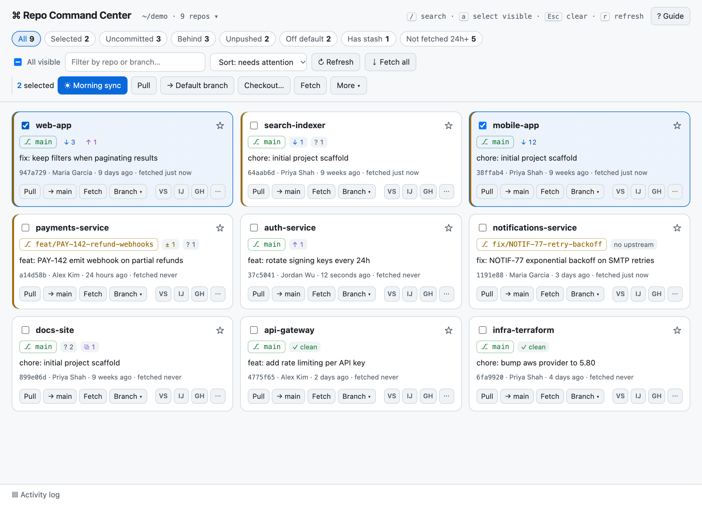

# ⌘ Repo Command Center

**One dashboard for every git repo in a folder.** See which repos are behind, dirty, or on the wrong
branch at a glance, then pull, switch, stash, or open them in your editor, one at a time or dozens at once.



- **Zero install:** Python standard library only. Two files, no `pip`, no `npm`, no build step.
- **Cross-platform:** macOS, Linux and Windows. Needs Python 3.8+ and git.
- **Fast:** status for ~100 repos loads in about 1.5 seconds.
- **Safe by default:** fast-forward-only pulls, never deletes unmerged work, never hangs on a password prompt.

---

## Why

If you work across many microservices, deploy repos and libraries, your mornings look like this:

```bash
for d in */; do (cd "$d" && git switch main && git pull); done   # ...and then untangle the failures
```

Repo Command Center replaces that with a page where every repo is a tile showing its branch, how far
behind or ahead it is, uncommitted changes and stashes. You can filter to the repos that need attention
and act on all of them with one click, with per-repo results, so nothing fails silently.

## Quick start

```bash
git clone git@github.com:Badrri-Narayanan/repo-command-center.git ~/tools/repo-command-center

cd ~/code                                         # any folder that contains git repos
python3 ~/tools/repo-command-center/server.py     # opens http://127.0.0.1:8765
```

Add an alias so it's one word from anywhere:

```bash
# ~/.zshrc or ~/.bashrc
alias rcc='python3 ~/tools/repo-command-center/server.py'
```

```powershell
# Windows: PowerShell profile
function rcc { py $HOME\tools\repo-command-center\server.py @args }
```

Then just `cd ~/code && rcc`, or `rcc ~/code`.

## Usage

```
python3 server.py [FOLDER] [--depth N] [--port PORT] [--no-browser]
```

| Option | Default | Description |
|---|---|---|
| `FOLDER` | current directory | Folder containing your repos |
| `--depth N` | `1` | Folder levels to search (1–4). Use `2` for `~/code/<org>/<repo>` layouts |
| `--port PORT` | `8765` | Starting port; the next free one is used if it's taken |
| `--no-browser` | off | Don't open a browser tab automatically |

You can also switch folder or depth at runtime: **click the folder path in the header**. Recent folders are remembered.

## Features

### Every repo at a glance

| Signal | Meaning |
|---|---|
| `⎇ main` (green) / `⎇ feat/x` (amber) | On the default branch / on another branch (default auto-detected from `origin/HEAD`) |
| `↓ 3` `↑ 2` | Behind / ahead of upstream |
| `± 4` `? 5` | Modified tracked files / untracked files |
| `⧉ 1` | Stash entries you may have forgotten |
| `⚠ conflicts`, `no upstream`, `✓ clean` | Self-explanatory |
| Amber / red left edge | Needs attention / error or conflicts. Sorted to the top by default |

Each tile also shows the last commit (message, author, age) and **when the repo was last fetched**.

### Per-repo actions

- **Pull:** `git pull --ff-only`
- **→ main:** switch to the repo's default branch
- **Fetch:** `git fetch --all --prune`
- **Branch ▾:** searchable picker of local and remote branches, newest first
- **Open in** VS Code, Cursor, IntelliJ, plus your file manager and terminal (only installed tools are shown)
- **GH / GL / BB:** open the repo on GitHub, GitLab or Bitbucket, with links to PRs/MRs, CI, and *open a PR for this branch*
- **⋯ menu:** stash (incl. untracked), pop stash, prune merged branches, copy path, refresh

### Group operations

Select repos with checkboxes, **All visible**, or the `a` key, then run:

| Action | What it does |
|---|---|
| **☀ Morning sync** | `fetch` → switch to default branch → `pull --ff-only`, per repo |
| **Pull** | Fast-forward each repo's current branch |
| **→ Default branch** | Switch every selected repo to its own default branch |
| **Checkout…** | Switch every selected repo to a named branch (repos without it are skipped) |
| **Fetch / Stash / Pop / Prune / Open** | Under the bulk bar and **More ▾** |

Up to 6 repos run in parallel, each with its own spinner and result line (ok / skipped with reason /
failed). A summary toast shows totals, and the **Activity log** keeps the full git output.

### Filters and recipes

Filter chips: **Behind · Uncommitted · Unpushed · Off default · Has stash · Not fetched 24h+ · Errors · Pinned · Selected**.
They combine with search (which also matches branch names) and **All visible**:

- *Update only what's stale:* **Behind** → All visible → Pull
- *Get everything back on main:* **Off default** → All visible → → Default branch
- *Find forgotten work:* **Unpushed**, **Uncommitted**, **Has stash**
- *Work on one ticket across repos:* search `PROJ-123` → select → Open in editor

### Keyboard

| Key | Action |
|---|---|
| `/` | Focus search |
| `a` | Select all visible tiles |
| `Esc` | Close popup → leave search → clear selection |
| `r` | Refresh status (local only, no network) |
| `?` | Open the in-app guide |

## Configuration

Editors and tools are detected automatically:

| Tool | macOS | Linux | Windows |
|---|---|---|---|
| VS Code / Cursor / IntelliJ | CLI on `PATH` (`code`, `cursor`, `idea`) or the `.app` | CLI on `PATH` | CLI on `PATH` |
| File manager | Finder | `xdg-open` | Explorer |
| Terminal | iTerm if installed, else Terminal | gnome-terminal, konsole, xfce4-terminal, x-terminal-emulator | Windows Terminal, else cmd |

Add, relabel or hide tools in `~/.repo-command-center.json`:

```json
{
  "openers": [
    { "id": "sublime", "label": "Sublime Text", "short": "ST", "cmd": ["subl", "{path}"] },
    { "id": "pycharm", "label": "PyCharm",      "short": "PC", "cmd": ["pycharm", "{path}"] },
    { "id": "terminal", "cmd": ["open", "-a", "Warp", "{path}"] },
    { "id": "cursor", "cmd": null }
  ]
}
```

- `{path}` is replaced with the repo's folder.
- `"kind": "editor"` (default for new tools) adds a button on every tile; `"kind": "system"` lists it only in the ⋯ menu.
- `"cmd": null` hides a built-in tool.

### Changing the "uncommitted changes" policy

When a switch or Morning sync hits a repo with uncommitted tracked changes, that repo is **skipped** and
the reason is shown on its tile. To auto-stash instead, edit `before_switch()` at the top of `server.py`.
Its docstring has a ready-made example.

## How it works

```
┌──────────────── browser ────────────────┐        ┌──────────── server.py ────────────┐
│ index.html (vanilla JS, no CDN)         │  HTTP  │ ThreadingHTTPServer on 127.0.0.1  │
│ • one status request per repo (×10)     │ ─────▶ │ • GET  /api/repos, /api/status,   │
│ • one op request per repo (×6) so each  │ ◀───── │        /api/branches              │
│   tile gets its own spinner + result    │  JSON  │ • POST /api/op, /api/root         │
└─────────────────────────────────────────┘        │ • runs `git -C <repo> …` per call │
                                                   └───────────────────────────────────┘
```

- Status comes mainly from one `git status --porcelain=v2 --branch` call per repo (branch, upstream,
  ahead/behind and file counts together), plus small calls for the last commit, stashes and remote URL.
- The server is stateless: each request names one repo and one operation. Bulk work is fanned out by
  the browser, which is what gives per-tile progress for free.
- Settings like pins, sort and recent folders live in your browser's `localStorage`.

## Security

The server executes git commands, so it's locked down:

- Listens on **`127.0.0.1` only**, never on your network.
- Every API call needs a **random per-run token** embedded in the page. Other websites can't read the
  page, so they can't get the token.
- The **`Host` header is checked**, which blocks DNS-rebinding attacks.
- Commands run **without a shell**, with arguments as lists. Branch names are validated with
  `git check-ref-format`, and repo names must match a discovered repo (no path traversal).
- Git runs with `GIT_TERMINAL_PROMPT=0` and SSH `BatchMode`, so it fails fast instead of waiting for credentials.

## Troubleshooting

| Problem | Fix |
|---|---|
| "No git repositories found" | Repos are nested deeper: use `--depth 2`, or click the folder path and change depth |
| Pull says *not possible to fast-forward* | Your branch has diverged from upstream. Resolve it in your IDE or terminal (by design, nothing is merged for you) |
| Pull or fetch fails with *Permission denied (publickey)* | Git can't use your SSH key non-interactively. Load it into your agent (`ssh-add`) or check `~/.ssh/config` |
| An editor button is missing | Its CLI isn't on `PATH`. Install the shell command (e.g. VS Code: *Shell Command: Install 'code'*) or add it in `~/.repo-command-center.json` |
| Pins and settings reset | They're stored per browser and port. Use the same `--port` to keep them |

## Project layout

```
server.py            HTTP server, git operations, tool detection (Python stdlib)
index.html           Page markup and the in-app guide
static/app.css       Styles (light + dark theme via prefers-color-scheme)
static/app.js        UI logic: rendering, filters, bulk operations, popovers
tests/test_server.py Test suite (unittest + real temporary git repos)
docs/                README assets
```

## Testing

The tests use only the standard library. Each test builds real throwaway git repos (a bare "remote",
a clone, and a second clone that pushes upstream commits), so pull, switch, stash, prune, conflicts and
worktrees are exercised against real git, not mocks. Your own git config is ignored during the run.

```bash
python3 -m unittest discover -s tests -v
```

Coverage (currently **100% line and branch** for `server.py`; the build fails below 95%):

```bash
# with uv: nothing to install globally
uv run --with coverage coverage run -m unittest discover -s tests
uv run --with coverage coverage report        # or: coverage html → htmlcov/index.html

# or with pip
pip install coverage && coverage run -m unittest discover -s tests && coverage report
```

| Area | What's covered |
|---|---|
| Git status | Clean, dirty (staged/unstaged/untracked), ahead/behind, detached HEAD, merge conflicts, stashes, empty and broken repos |
| Operations | Fetch, ff-only pull (incl. diverged → error), switch/checkout (invalid names, remote-only branches, dirty → skipped), morning sync short-circuiting, stash round-trip, prune merged-only |
| Discovery | Depth, nested repos, skipped folders, worktrees, app folder excluded, unknown/traversal repo ids |
| Tools | Per-platform detection (macOS/Linux/Windows via mocks), config add/override/hide, invalid config |
| HTTP API | Token + Host checks, static whitelist and path traversal, every route, 400/401/403/404/500 |
| CLI | Port fallback, `--no-browser`, bad folder, git missing |

The front end (`static/app.js`) is checked by hand in a browser; it has no automated tests yet.

## Contributing

Issues and PRs are welcome. Keep the zero-dependency rule: standard-library Python and vanilla JS only.
Run the tests before opening a PR.
